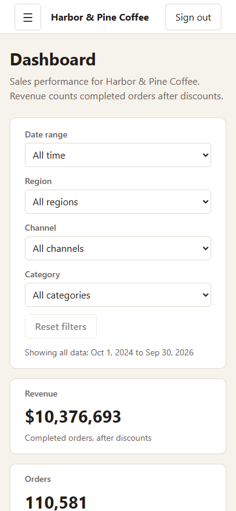
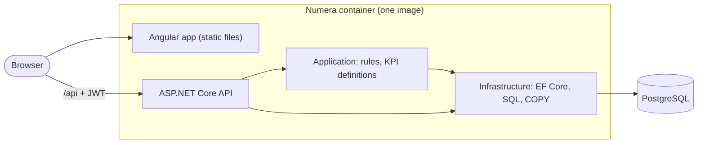

# Numera: Reporting Reimagined

Upload a sales CSV, get clear KPIs and charts, drill down to the rows behind any number, and export exactly what you are looking at.

Numera is an **independent portfolio project**, built by Bojan Petkovski as a solo developer **with AI assistance** (Claude, an AI coding assistant, under the rules in [CLAUDE.md](CLAUDE.md)). All data is fictional: an invented coffee roaster, "Harbor & Pine Coffee".


## Why

Small teams often keep sales data in spreadsheets and answer questions by hand: what sold last quarter, which region is behind, which orders make up that refund spike. Numera turns a CSV export into a reporting tool: import with row-level validation, KPIs defined once and computed in the database, filters that apply everywhere, and a path from any chart to the underlying rows and back out as a CSV.

## Live demo

**Link: added after deployment** (Render free tier with a Neon free database; see [Deploy](#deploy)).

Sign in with the demo account shown on the sign-in page: `demo@numera.example` / `Demo-Pass-2026!` (documented demo values, not a real account).

> **Cold start:** the demo runs on free tiers. After about 15 minutes without visitors the server sleeps, and the first page load can take up to a minute while it wakes. After that it responds normally.

Everyone shares the demo data. **Settings > Reset demo data** puts it back to the original state.

## Features

- **CSV import** with validation per row:
  - limits of 10 MB and 100,000 rows;
  - rejected rows are skipped and listed with a reason in a downloadable error report;
  - re-imported rows are recognized and not counted twice;
  - an import history.
- **Dashboard:**
  - revenue, orders, average order value and refund rate;
  - revenue over time by day, week or month;
  - revenue by category and by region.
- **Filters** for date range (presets or custom), region, channel and category, shared by the dashboard and the grid and kept in the URL, so a link reproduces the view.
- **Orders grid:**
  - server-side paging and sorting on every column;
  - status filter and order ID search;
  - a card layout on phones.
- **Drill-down:** click a bar or a point, or use the keyboard, to open the grid on exactly the order lines behind that number. Active filters show as removable chips.
- **CSV export** of the grid's current view (all pages, same order). It streams from the database and is protected against spreadsheet formula injection.
- **Demo reset** from the Settings page, with confirmation.
- **States and accessibility:**
  - loading, empty, error and success states on every screen;
  - keyboard navigation and a skip link;
  - checked with axe at phone, tablet and desktop widths (results in [PROGRESS.md](PROGRESS.md)).

| | |
|---|---|
|  |  |
| Drill-down from the dashboard into the orders grid | Import result with rejected rows and the error report |



## Architecture



- **One image:** the API serves the built Angular app, so both share one origin; the same image runs in Docker Compose, in CI and on the hosted demo.
- **Layers:** `Numera.Api` (endpoints, auth, limits; no business logic), `Numera.Application` (rules and KPI definitions, testable without a database), `Numera.Infrastructure` (EF Core, hand-written PostgreSQL for aggregates and bulk loads). Light CQRS: one handler per command or query.
- **Metrics in SQL:** every KPI and chart is a single SQL statement over the filtered rows. The definitions are written down once in [docs/ARCHITECTURE.md](docs/ARCHITECTURE.md) and tested against hand-computed data.

More detail: [docs/ARCHITECTURE.md](docs/ARCHITECTURE.md). The reasons behind each choice: [DECISIONS.md](DECISIONS.md).

## Tech stack

| Part | Choice | Why |
|---|---|---|
| API | ASP.NET Core on .NET 10 (LTS), minimal APIs | Long-term support, fast, little ceremony for a focused API |
| Data | PostgreSQL 17, EF Core 10, Npgsql | Schema and migrations with EF Core; hand-written SQL where PostgreSQL does it better (aggregates, `COPY`, trigram search) |
| Frontend | Angular 22, standalone components, Signals, NgRx SignalStore | Typed and structured; Signals for local state, a store only for state shared across screens (filters, import status) |
| Charts | Chart.js 4 | Mature and light enough, with good control over accessibility |
| Tests | xUnit, Testcontainers (real PostgreSQL), Vitest component tests, Playwright | Database tests run against the real engine, not a substitute |
| Delivery | Docker (multi-stage, non-root), Docker Compose, GitHub Actions, Render + Neon | One command locally; CI runs the real image end to end |

## Run it locally

### With Docker only (quickest)

Requires Docker.

```bash
git clone https://github.com/bojanpetkovski18/numera.git
cd numera
cp .env.example .env
```

In `.env`, replace the two placeholders: `POSTGRES_PASSWORD` (any password) and `JWT_SIGNING_KEY` (at least 32 random characters, for example from `openssl rand -base64 48`). Then:

```bash
docker compose up --build
```

Open http://localhost:8080 and sign in with the demo account. The first start creates the database and loads the 200,000-row demo dataset before the app answers.

### For development

Requires the .NET 10 SDK, Node.js 24 and Docker.

```bash
cp .env.example .env               # set POSTGRES_PASSWORD, and use the same password in ConnectionStrings__Numera
docker compose up -d postgres      # database only
```

Set the API's settings as environment variables (`Jwt__SigningKey`, `ConnectionStrings__Numera`; see `.env.example`), then:

```bash
dotnet run --project src/Numera.Api -- seed   # create the schema and load the demo data
dotnet run --project src/Numera.Api           # API on http://localhost:5080
cd web && npm ci && npm start                 # app on http://localhost:4200, proxies /api to the API
```

All commands, including migrations and maintenance, are listed in [CLAUDE.md](CLAUDE.md#commands-verified-in-m01-unless-noted).

## Tests

```bash
dotnet test                                   # unit tests and integration tests (needs Docker: Testcontainers starts PostgreSQL)
cd web && npm test -- --watch=false           # Angular component and unit tests
```

End to end (Playwright), against the stack from `docker compose up --build`:

```bash
cd e2e && npm ci && npx playwright install chromium && npx playwright test
```

CI runs all three on every push and pull request.

## Deploy

The hosted demo is one Render web service built from the `Dockerfile`, with a Neon PostgreSQL database.

1. Create a free Neon project (region AWS Frankfurt, to sit next to the Render service). Copy the **direct** (not pooled) connection details and write them in Npgsql form:
   `Host=<host>;Database=<db>;Username=<user>;Password=<password>;SSL Mode=Require;Gss Encryption Mode=Disable`
2. In Render, choose **New > Blueprint**, connect this repository and select `render.yaml`. When asked, paste the connection string into `ConnectionStrings__Numera`. Render generates the JWT signing key itself.
3. The first deploy creates the schema and loads the demo data (`Database__PrepareOnStartup=true`). The service then deploys again on every push to `dev`.

Free-tier limits and cost are recorded in [DECISIONS.md](DECISIONS.md) (D052).

## Technical decisions and challenges

- **KPIs that agree everywhere.** Revenue, orders and refund rate are defined once and computed in SQL; drill-downs open exactly the rows behind a number. An integration test checks, for every point and bar of several charts, that the grid's rows add up to the chart's value.
- **Imports that stay fast and honest.** Valid rows stream into a staging table with binary `COPY`; duplicates and invalid rows are reported per row instead of failing the whole file. Measured: a 100,000-row file in about 4.5 s on the dev machine (details in [PROGRESS.md](PROGRESS.md)).
- **Exports that match the grid exactly.** The grid and the export share one query builder and the export reads from a single database snapshot. More than 100,000 rows is refused rather than silently truncated. A 95,924-row export streamed in about 0.2 s, with the API's memory barely moving (measured; see PROGRESS).
- **URL as the source of truth for filters.** Reloads, shared links, back/forward and drill-downs all reproduce the same view; one function writes the URL, after a bug where two writers overwrote each other.
- **Production surprises caught before release.** The strict Content-Security-Policy blocked Angular's inlined critical CSS in the production build only; the end-to-end test now fails on any console error, so CI catches it. Details in [DECISIONS.md](DECISIONS.md) (D053).
- **Honest limits.** Free-tier cold starts, a shared demo dataset, a 60-minute session without refresh tokens, and the absence of a screen-reader test run are documented in [PROGRESS.md](PROGRESS.md) under known issues.

## Project documents

- [Specification](docs/SPEC.md) and [architecture](docs/ARCHITECTURE.md)
- [Decisions](DECISIONS.md), [progress and measurements](PROGRESS.md)
- [Rules for the AI coding assistant](CLAUDE.md) and the [milestone prompts](prompts/) the project was built from
- [Portfolio summary](docs/portfolio/)

## About

Built by Bojan Petkovski as an independent portfolio project, with AI assistance (Claude) for code, tests and documentation, reviewed and directed milestone by milestone. All company names, people and figures in the data are fictional.
