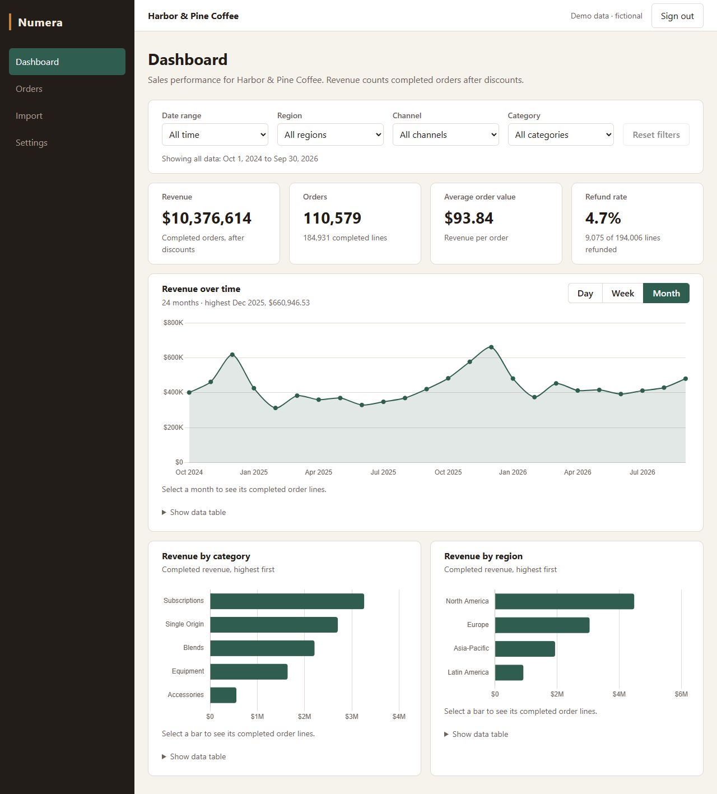
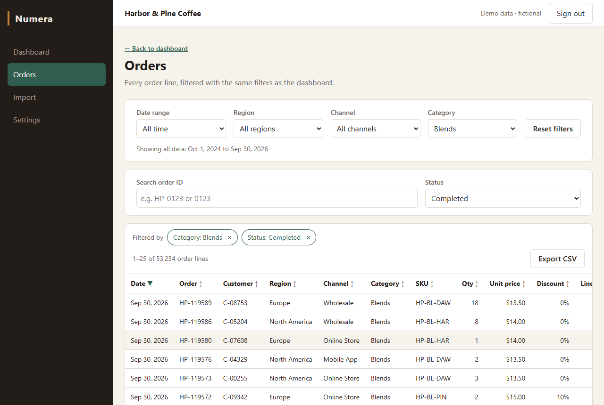
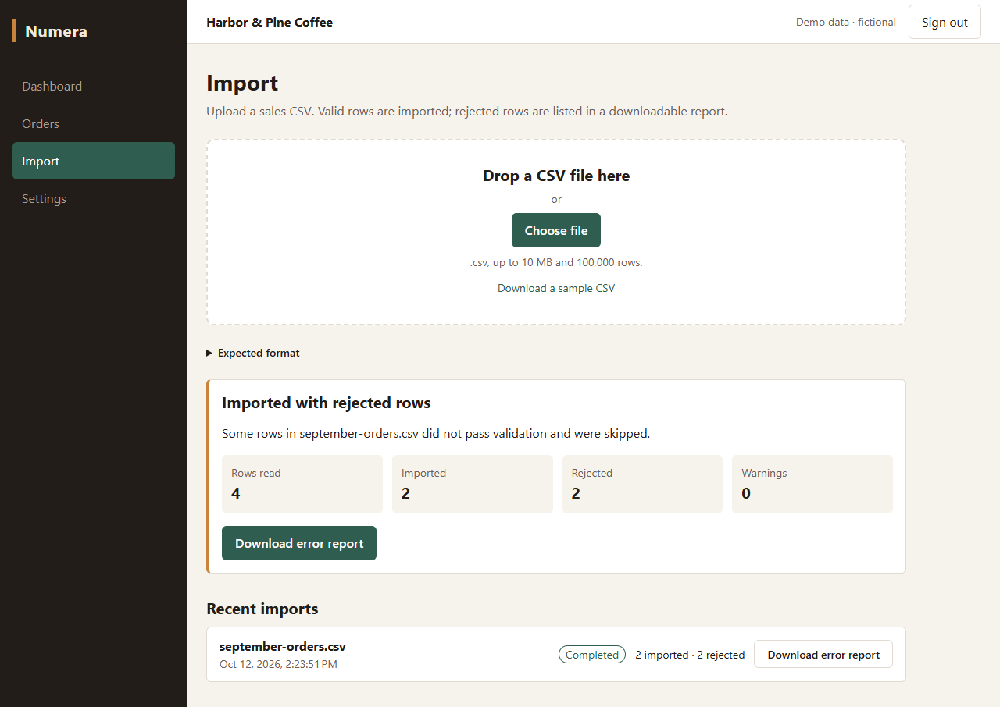

# Numera: Reporting Reimagined

**Turn a sales spreadsheet into a reporting dashboard.** Upload a CSV, see clear KPIs and charts, click any number to see the rows behind it, and export exactly what you are looking at.



Numera is an independent portfolio project by **Bojan Petkovski**, a full-stack developer (Angular, .NET, PostgreSQL), built **with AI assistance** (Claude). All data is fictional: an invented coffee roaster, "Harbor & Pine Coffee".

---

## What it does

Many small businesses keep their sales in spreadsheets and answer questions by hand: *What did we sell last quarter? Which region is behind? Which orders make up that spike in refunds?* Numera answers them in a few clicks.

- **Import your data.** Upload a sales CSV (up to 10 MB and 100,000 rows). Every row is checked: good rows are imported, problem rows are skipped and listed with the reason, in a report you can download.
- **See the numbers that matter.** Revenue, number of orders, average order value and refund rate, plus revenue over time and by product category and region.
- **Filter once, everywhere.** Pick a date range, region, channel or category, and the dashboard and the orders list follow. The filters are part of the link, so you can bookmark or share a view.
- **Click a number to see why.** Click a bar or a point on a chart and you get the exact order lines behind it.
- **Take it with you.** Export the current view to CSV, ready for Excel.
- **Works on a phone**, and with the keyboard.

| | |
|---|---|
|  |  |
| From a chart to the rows behind it | An import with rejected rows and their report |

## Try it

### Option 1: the live demo

**Link: coming soon.** It will run on a free hosting plan: if nobody has used it for about 15 minutes, the first page can take up to a minute to load while the server wakes up. After that it is quick.

### Option 2: run it on your own computer (about 10 minutes)

You need **Docker Desktop** (free for personal use) and nothing else: no programming tools.

1. **Install and start Docker Desktop** from [docker.com](https://www.docker.com/products/docker-desktop/). Wait until it shows that Docker is running.
2. **Download Numera.** On this page, click the green **Code** button, then **Download ZIP**, and unzip it. If you use Git, `git clone https://github.com/bojanpetkovski18/numera.git` does the same.
3. **Open a terminal in the unzipped folder** (the folder that contains `docker-compose.yml`):
   - Windows: open the folder in File Explorer, click the address bar, type `powershell` and press Enter.
   - macOS: open Terminal, type `cd `, drag the folder into the window and press Enter.
4. **Create the settings file.** Copy and paste the block for your system. It creates a file named `.env` with a random database password and a random security key, for this computer only.

   **Windows (PowerShell):**
   ```powershell
   $rng = [Security.Cryptography.RandomNumberGenerator]::Create()
   $pw = New-Object byte[] 16; $rng.GetBytes($pw); $key = New-Object byte[] 48; $rng.GetBytes($key)
   (Get-Content .env.example) -replace '^POSTGRES_PASSWORD=.*', "POSTGRES_PASSWORD=$(-join ($pw | ForEach-Object { $_.ToString('x2') }))" -replace '^JWT_SIGNING_KEY=.*', "JWT_SIGNING_KEY=$([Convert]::ToBase64String($key))" | Set-Content .env
   ```

   **macOS or Linux (Terminal):**
   ```bash
   sed -e "s|^POSTGRES_PASSWORD=.*|POSTGRES_PASSWORD=$(openssl rand -hex 16)|" \
       -e "s|^JWT_SIGNING_KEY=.*|JWT_SIGNING_KEY=$(openssl rand -base64 48 | tr -d '\n')|" .env.example > .env
   ```
5. **Start Numera:**
   ```
   docker compose up --build -d
   ```
   The first time takes a few minutes: Docker downloads what it needs, builds the app, and loads 200,000 rows of sample data.
6. **Open http://localhost:8080** in your browser. If the page does not load yet, wait a minute and refresh.
7. **Sign in:** click **Fill in demo credentials**, then **Sign in**. The demo account is `demo@numera.example` / `Demo-Pass-2026!`.

When you are done, run `docker compose down` in the same folder. Your data is kept for next time (`docker compose up -d` starts it again). To remove everything, run `docker compose down -v` and delete the folder.

<details>
<summary>If something does not work</summary>

- **"port is already allocated" for 8080:** another program uses that port. Open `.env` in a text editor, add the line `WEB_PORT=8081`, run step 5 again and open http://localhost:8081.
- **"port is already allocated" for 5432:** another database runs on your computer. Add `POSTGRES_PORT=5433` to `.env` and run step 5 again.
- **The page keeps failing to load:** run `docker compose ps`. Both `app` and `postgres` should say `running`. If not, `docker compose logs app` shows why.
- **"docker: command not found" or a pipe error:** Docker Desktop is not running. Start it and try again.

</details>

### A five-minute tour

1. **Dashboard:** pick a **Region**, then a **Category**. Every number and chart follows. Switch the chart between **Day**, **Week** and **Month**. (The sample data covers October 2024 to September 2026; for dates, use **Custom range** within that period.)
2. **Click to see the rows:** click a bar in **Revenue by category**. The **Orders** page opens with exactly those order lines. The chips at the top show why they are filtered; click **×** on a chip to widen the view.
3. **Orders:** click a column header to sort, type part of an order number (for example `0123`) in the search box, and page through.
4. **Export:** click **Export CSV** and open the file in Excel. It holds every row of the current view, in the same order.
5. **Import:** on **Import**, download the sample CSV, upload it, and look at the result: what was imported, what was rejected and why. **Download error report** gives the reasons per row.
6. **Start over:** **Settings > Reset demo data** puts the original data back.

---

## How it is built


| Part | Choice | Why |
|---|---|---|
| Backend | ASP.NET Core on .NET 10 (LTS), minimal APIs, C# | Long-term support, fast, little ceremony for a focused API |
| Database | PostgreSQL 17, EF Core 10, Npgsql | Migrations with EF Core; hand-written SQL where PostgreSQL does it better (aggregates, bulk `COPY`, trigram search) |
| Frontend | Angular 22 (standalone components, Signals), NgRx SignalStore, Chart.js | Typed and structured; a store only for state shared across screens (filters, import status) |
| Tests | xUnit, Testcontainers (a real PostgreSQL), Vitest component tests, Playwright end-to-end | Database code is tested against the real engine, and the whole flow in a real browser |
| Delivery | Docker (multi-stage, non-root), Docker Compose, GitHub Actions | One command to run; CI tests the same image that is deployed |

- **One image:** the API also serves the Angular app, so the whole product is one container plus a database.
- **Numbers that agree everywhere:** every KPI and chart is one SQL query in PostgreSQL, from definitions written down once in [docs/ARCHITECTURE.md](docs/ARCHITECTURE.md). Clicking a chart opens exactly the rows behind its value, and an automated test checks that those rows add up to the value for every point and bar.
- **Imports that report instead of failing:** rows stream into the database with PostgreSQL's bulk `COPY`; invalid and duplicate rows are recorded with the reason and the rest are imported. A 100,000-row file took about 4.5 s on the development machine.
- **Exports that match the screen:** the grid and the export share one query and read one consistent snapshot of the data. A 95,924-row export streamed in about 0.2 s without the server holding the file in memory. Larger exports than 100,000 rows are refused with a clear message rather than cut short.
- **Security basics:** sign-in with JWT, every data endpoint protected, rate limits on sign-in and reset, upload size and row limits, protection against spreadsheet formula injection in exports, a strict Content-Security-Policy, and no secrets in the repository.
- **Accessibility:** keyboard navigation, a skip link, focus handling between pages, and an axe check at phone, tablet and desktop widths with no violations reported.

Measurements and how they were taken are in [PROGRESS.md](PROGRESS.md); the reasons behind each choice are in [DECISIONS.md](DECISIONS.md).

## For developers

### Run it for development

Requires the .NET 10 SDK, Node.js 24 and Docker.

```bash
cp .env.example .env               # set POSTGRES_PASSWORD, JWT_SIGNING_KEY, and the same password in ConnectionStrings__Numera
docker compose up -d postgres      # database only
```

Set the API's settings as environment variables (`Jwt__SigningKey`, `ConnectionStrings__Numera`; see `.env.example`), then:

```bash
dotnet run --project src/Numera.Api -- seed   # create the schema and load the demo data
dotnet run --project src/Numera.Api           # API on http://localhost:5080
cd web && npm ci && npm start                 # app on http://localhost:4200 (proxies /api to the API)
```

Every command, including migrations and maintenance, is listed in [CLAUDE.md](CLAUDE.md#commands-verified-in-m01-unless-noted).

### Tests

```bash
dotnet test                                   # unit and integration tests (needs Docker: Testcontainers starts PostgreSQL)
cd web && npm ci && npm test -- --watch=false # Angular component and unit tests
```

End to end (Playwright), against the app from `docker compose up --build -d`:

```bash
cd e2e && npm ci && npx playwright install chromium && npx playwright test
```

CI runs all three on every push and pull request.

### Deploy

The hosted demo is one Render web service built from the `Dockerfile`, with a free Neon PostgreSQL database:

1. Create a Neon project (AWS Frankfurt). Take the **direct** (not pooled) connection details and write them as
   `Host=<host>;Database=<db>;Username=<user>;Password=<password>;SSL Mode=Require;Gss Encryption Mode=Disable`.
2. In Render: **New > Blueprint**, select this repository and `render.yaml`, and paste the connection string into `ConnectionStrings__Numera` when asked. Render generates the signing key.
3. The first start creates the schema and loads the demo data. Free-tier limits and cost are in [DECISIONS.md](DECISIONS.md) (D052).

### Project documents

- [Specification](docs/SPEC.md), [architecture](docs/ARCHITECTURE.md), [decisions](DECISIONS.md), [progress and measurements](PROGRESS.md)
- [Rules for the AI coding assistant](CLAUDE.md) and the [milestone prompts](prompts/) the project was built from
- [Portfolio summary](docs/portfolio/)

## About

Built by Bojan Petkovski as an independent portfolio project, with AI assistance (Claude) for code, tests and documentation, directed and reviewed milestone by milestone. Every company name, person and figure in the data is fictional.

**Need something like this for your own data?** Dashboards, reporting tools, CSV import pipelines and Angular + .NET applications are the kind of work I do. Get in touch through my Upwork profile.
