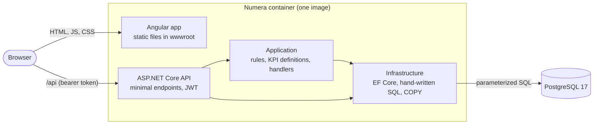

# Numera Architecture

How Numera is put together, as built. Decisions and their reasons are in [DECISIONS.md](../DECISIONS.md) (referenced as Dnnn).

## Overview

- One production image: the API also serves the built Angular app, so the app and the API share one origin (no CORS in production). Locally, the Angular dev server proxies `/api` to the API instead (D051).
- Every aggregation (KPIs, charts, grid totals) runs in PostgreSQL. The application never loads all orders to sum them.
- The same image runs in Docker Compose, in the CI end-to-end test and on the hosted demo.

## Request flow

1. The browser loads the Angular app. Routes are lazy-loaded; unknown paths show a "not found" page.
2. Sign-in (`POST /api/auth/login`) returns a 60-minute JWT. The app keeps it in `sessionStorage` and an HTTP interceptor adds it to every API call. A route guard sends signed-out users to the sign-in page, and a 401 from the API does the same.
3. Every endpoint except sign-in and `/health` requires a valid token (fallback authorization policy). Sign-in and the demo reset are rate limited per client address.
4. Invalid input gets RFC 7807 problem details naming each field, which the screens show as written.

## Frontend

- Angular 22, standalone components, Signals for local state, zoneless change detection.
- Shared state in NgRx SignalStores: `FilterStore` (date range, region, channel, category, chart granularity) and `ImportStore` (upload progress, result, history).
- The filters live in the URL (`syncFiltersWithUrl` is the only writer), so reloads, shared links, back/forward and drill-downs all restore the same view (D035, D039, D043).
- Data loading with `httpResource`: each widget has its own loading, empty, error and success state.
- Charts: Chart.js behind one `ChartCanvas` component, with keyboard navigation and a data table for each chart (D034, D042).

## Import pipeline

1. `POST /api/imports` (multipart, at most 10 MB): file name, content type and a binary sniff are checked before any parsing.
2. A first pass reads the header and counts rows (at most 100,000) without loading the file into memory.
3. In one transaction, under the order-write advisory lock shared with the demo reset (D047): valid rows stream into a temporary staging table through binary `COPY`; rows whose `order_id` and `product_sku` already exist move to `import_errors` in one statement; the rest are inserted into `orders`.
4. Each rejected row is recorded with its row number, field and reason; `GET /api/imports/{id}/errors.csv` streams the report.
5. Text that would run as a formula in a spreadsheet is neutralized in every CSV the app writes (`CsvCell`).

## Security

- Secrets (JWT signing key, database password) come from environment variables; the repository holds placeholders only.
- Request size limits: 1 MB by default, 10 MB plus the multipart envelope for imports.
- Response headers: `X-Content-Type-Options: nosniff`, `X-Frame-Options: DENY`, `Referrer-Policy`, and a Content-Security-Policy that allows only same-origin scripts (D053).
- Only parameterized SQL; sort columns and other identifiers come from fixed lists, never from input.
- Containers run as non-root users.

## Deployment

- `docker compose up --build` runs PostgreSQL and the app (http://localhost:8080). With `Database__PrepareOnStartup=true`, the app applies migrations and loads the demo data into an empty database on its first start.
- The hosted demo is one Render free web service built from the same `Dockerfile` (`render.yaml`), with a free Neon PostgreSQL database (D052).
- CI (GitHub Actions) builds and tests the API and the web app, then builds the image, starts the stack with Compose and runs the Playwright end-to-end test against it.

## Layers
| Project | Holds |
|---|---|
| `Numera.Api` | Minimal API endpoints, auth, rate and size limits, problem details, security headers, and (in the production image) the Angular app's static files. No business logic. |
| `Numera.Application` | Entities, pure rules (import validation, KPI definitions, order filter), DTOs, EF-based handlers via `INumeraDbContext`. |
| `Numera.Infrastructure` | EF Core `NumeraDbContext` and migrations, PostgreSQL-specific handlers (CSV import with `COPY`, metrics SQL), seeding, JWT. |

PostgreSQL-specific work (bulk `COPY`, hand-written aggregate SQL) lives in Infrastructure (DECISIONS D024, D032); rules that can be tested without a database live in Application.

## KPI definitions

These are the definitions every metric follows (`MetricDefinitions` in `Numera.Application/Metrics`).

- **Line revenue** = quantity x unit_price x (1 - discount).
- **Revenue** counts lines with status `completed` only.
- **Orders** = number of distinct `order_id` among completed lines.
- **Average order value** = revenue / orders (0 when there are no orders).
- **Refund rate** = refunded lines / (completed + refunded lines), as a fraction. Cancelled lines are excluded from both sides. 0 when there are no completed or refunded lines.

Precision and rounding:

- Line revenue and all sums are exact `numeric` in PostgreSQL. Rounding happens once, on the total being reported.
- Money (revenue, average order value) is rounded to 2 decimals, half away from zero. The average order value divides the unrounded revenue.
- Refund rate is rounded to 4 decimals.
- Because each total is rounded separately, the sum of rounded group or period revenues can differ from the rounded overall revenue by a cent or two.
- An order whose lines fall into several groups (for example two categories) is counted once in each of those groups, so group order counts can add up to more than the overall order count.

## Order filter

One filter model (`OrderFilter`) is used by every metrics query and, from M08, by the orders grid.

| Query parameter | Meaning |
|---|---|
| `from`, `to` | Inclusive dates, `yyyy-MM-dd`; `from` must not be after `to`. |
| `region`, `channel`, `category` | Exact match. Repeat the parameter for "any of": `?region=Europe&region=Asia-Pacific`. At most 20 values, 60 characters each. |
| `status` | Grid only. Rejected by metrics endpoints, because revenue and orders are defined on completed lines. |

Invalid input returns a 400 validation problem that names each failing parameter.

## Metrics endpoints

| Endpoint | Returns |
|---|---|
| `GET /api/metrics/summary` | `revenue`, `orders`, `averageOrderValue`, `refundRate`, `completedLines`, `refundedLines` |
| `GET /api/metrics/timeseries?granularity=day\|week\|month` | `points[]` of `periodStart`, `revenue`, `orders` (default granularity: month) |
| `GET /api/metrics/breakdown?by=category\|region\|channel` | `groups[]` of `key`, `revenue`, `orders`, sorted by revenue (descending), then key |

Timeseries details:
- Weeks start on Monday (ISO 8601); months on the 1st. `periodStart` is the first day of the period.
- Every period between the bounds is present; periods without data have zero revenue and orders.
- The bounds are the filter's `from` and `to`. When either is missing, the first or last order date matching the rest of the filter is used; when nothing matches, `points` is empty.
- At most 1,000 points per request; a longer range returns a 400 asking for a shorter range or larger granularity.

Breakdown details: groups that have only refunded or cancelled lines are listed with zero revenue and zero orders.

## CSV export

`GET /api/orders/export` returns every row `GET /api/orders` would return for the same filters, `status`, `q`, `sort` and `dir`, across all pages, in the same order (the two share `OrdersSql`).

- Columns: `order_id, order_date, customer_id, region, channel, product_sku, product_category, quantity, unit_price, discount, status, line_total` (the import columns plus the line total).
- UTF-8 with BOM, CRLF, ISO dates, invariant decimals, text cells protected against formula injection (`CsvCell`).
- Headers: `Content-Disposition` with a name like `numera-orders_20261011-234750Z_europe_refunded.csv`, `X-Row-Count`, `Cache-Control: no-store`.
- More than 100,000 matching rows returns 422 with `rowCount` and `maxRows`; no partial file is sent.
- Count and rows come from one read-only REPEATABLE READ snapshot; rows are streamed, not buffered (DECISIONS D044).

## Demo reset

`POST /api/demo/reset` (signed in, rate limited) restores the original demo data in one transaction: it truncates `orders` and `import_errors` (ids restart), deletes finished `import_jobs`, and bulk-loads the deterministic 200,000-row seed (the same code as the `seed` command). It shares an advisory lock with imports: if one is running, the reset returns 409 instead of waiting. Returns `{ orderLines, completedAt }` (DECISIONS D047).

## Drill-down

Clicking a chart item (or its data-table link) opens `/orders` with the dashboard filter narrowed to that item, plus `status=completed`:

| Chart item | Filter change |
|---|---|
| Category, region or channel bar | that dimension = the bar's key |
| Day, week or month point | `from`/`to` = the period (weeks Monday to Sunday, months to the last day) intersected with the active range |

The rows shown are then exactly the data behind the clicked value: their count equals `completedLines` from the summary for the same filter, their distinct `order_id` count equals the item's `orders`, and their line revenue sums to the item's `revenue` (DECISIONS D041).

All aggregation runs in PostgreSQL in a single statement per request (`SUM ... FILTER`, `COUNT(DISTINCT ...)`, `generate_series`); no rows are loaded into the application.