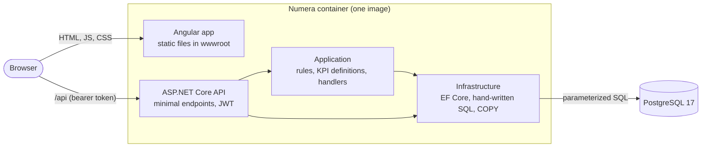

# Numera Architecture

How Numera is put together, as built. Decisions and their reasons are in [DECISIONS.md](../DECISIONS.md) (referenced as Dnnn).

## Overview

- One production image: the API also serves the built Angular app, so the app and the API share one origin (no CORS in production). Locally, the Angular dev server proxies `/api` to the API instead (D051).
- Every aggregation (KPIs, charts, grid totals) runs in PostgreSQL. The application never loads all orders to sum them.
- The same image runs in Docker Compose, in the CI end-to-end test and on the hosted demo.

## Request flow

1. The browser loads the Angular app. Routes are lazy-loaded; unknown paths show a "not found" page.
2. Sign-in (`POST /api/auth/login`) returns a 60-minute JWT. The app keeps it in `sessionStorage` and an HTTP interceptor adds it to every API call. A route guard sends signed-out users to the sign-in page, and a 401 from the API does the same.
3. Every endpoint except sign-in and `/health` requires a valid token (fallback authorization policy). Sign-in and the demo reset are rate limited per client address.
4. Invalid input gets RFC 7807 problem details naming each field, which the screens show as written.

## Frontend

- Angular 22, standalone components, Signals for local state, zoneless change detection.
- Shared state in NgRx SignalStores: `FilterStore` (date range, region, channel, category, chart granularity) and `ImportStore` (upload progress, result, history).
- The filters live in the URL (`syncFiltersWithUrl` is the only writer), so reloads, shared links, back/forward and drill-downs all restore the same view (D035, D039, D043).
- Data loading with `httpResource`: each widget has its own loading, empty, error and success state.
- Charts: Chart.js behind one `ChartCanvas` component, with keyboard navigation and a data table for each chart (D034, D042).

## Import pipeline

1. `POST /api/imports` (multipart, at most 10 MB): file name, content type and a binary sniff are checked before any parsing.
2. A first pass reads the header and counts rows (at most 100,000) without loading the file into memory.
3. In one transaction, under the order-write advisory lock shared with the demo reset (D047): valid rows stream into a temporary staging table through binary `COPY`; rows whose `order_id` and `product_sku` already exist move to `import_errors` in one statement; the rest are inserted into `orders`.
4. Each rejected row is recorded with its row number, field and reason; `GET /api/imports/{id}/errors.csv` streams the report.
5. Text that would run as a formula in a spreadsheet is neutralized in every CSV the app writes (`CsvCell`).

### Column mapping (M15)

Files whose column names or formats are not Numera's can be imported with a mapping (`ImportMapping` in `Numera.Application/Imports`).

- **Preview:** `POST /api/imports/preview` takes the same upload as an import, with the same checks, and returns:
  - the header and at most 20 rows, with cells cut to 200 characters;
  - `matchesNumeraFormat`;
  - a suggested mapping, `dateFormatAmbiguous`, and the fields left `unmapped`;
  - the user's saved mapping for files with the same headers, if any.

  Nothing is stored. Files with more than 100 columns are refused (422).
- **Mapping:** a source column for each of the 11 fields (each column feeds one field at most), a date format (`yyyy-MM-dd`, `dd/MM/yyyy`, `MM/dd/yyyy` or `dd.MM.yyyy`; day and month may have one digit except in the first), and the discount scale: a fraction (0.10) or a percentage (10 or 10%, at most one decimal, stored as 0.10). It is sent as JSON in the `mapping` form field of `POST /api/imports`. Without it, an import behaves exactly as before.
- **Same pipeline:** a mapping only changes which column index feeds each field and how dates and discounts are parsed. The two passes, the limits, the duplicate checks, the transaction and the error report are unchanged. Unmapped columns are ignored with a warning. A mapped column missing from the file rejects the file (422).
- **Error report:** for a mapped file, the `field` column names the source column (for example `Qty`), and row numbers count the file's own rows.
- **Suggestions** (`MappingSuggester`):
  - Columns are matched by name, ignoring case, spaces and punctuation, first to the field's own name and then to common synonyms ("Qty", "Order Number", "Date"). Each column is suggested for one field only.
  - The date format is the first that reads every sample date. It is flagged as ambiguous when another format reads them too (01/03/2025).
  - Discounts are suggested as percentages when a sample is above 1 or has a % sign.
- **Saved mappings:** `GET/POST /api/import-mappings`, `PUT/DELETE /api/import-mappings/{id}`.
  - Stored per user in `import_mappings`: name (unique per user, ignoring case), the mapping as JSON, and the file's headers (cleaned, lower-cased, sorted).
  - A preview offers the most recently updated saved mapping whose headers equal the file's, in any order.
  - Another user's mapping is always a 404.
  - At most 50 per user.
  - A demo reset deletes them.

## Security

- Secrets (JWT signing key, database password) come from environment variables; the repository holds placeholders only.
- Request size limits: 1 MB by default, 10 MB plus the multipart envelope for imports.
- Response headers: `X-Content-Type-Options: nosniff`, `X-Frame-Options: DENY`, `Referrer-Policy`, and a Content-Security-Policy that allows only same-origin scripts (D053).
- Only parameterized SQL; sort columns and other identifiers come from fixed lists, never from input.
- Containers run as non-root users.
- Every endpoint requires a signed-in user except login, health and the share-link endpoints under `/api/shared/{token}`, where the token is the credential (see below).

## Saved views and share links (M16)

- **Saved views** (`/api/views`: list, create, update or rename, delete; per user, at most 50, names unique per user ignoring case) store the dashboard's settings: date preset or custom dates, regions, channels, categories, granularity and comparison. They use the dashboard's validation rules. Presets stay relative: "Last 90 days" means the 90 days before the day the view is opened. On the dashboard, "Save view" and "Saved views" sit under the page title, and a note says which saved view the screen matches.
- **Share links** (`POST /api/views/{id}/shares` with `expiresInDays` 1, 7 or 30; `GET /api/shares` lists the active ones; `DELETE /api/shares/{id}` revokes):
  - The token is 32 random bytes, URL-safe base64 (43 characters). It is returned once, in the response that creates the link (sent with `no-store`).
  - Only its SHA-256 hash is stored (`share_links.token_hash`, unique index).
  - At most 10 active links per view. Deleting a view deletes its links.
- **Public endpoints** (`/api/shared/{token}`, `/summary`, `/timeseries`, `/breakdown`, `/drivers`):
  - They always use the view's saved filter and comparison, resolved to today's date (UTC). Query parameters cannot widen them: only the chart granularity and the breakdown dimension are read.
  - They return aggregates only: no endpoint exposes order rows through a token.
  - A malformed, unknown, revoked or expired token gets the same 404.
  - Responses carry `Cache-Control: no-store`, `Referrer-Policy: no-referrer` and `X-Robots-Tag: noindex, nofollow`. They are rate limited per client address (120 requests a minute by default, `RateLimiting:SharedPermitLimit`).
  - Token checks: the format is checked first, then the hash is looked up, so the token itself is never compared or stored.
  - Request paths, which hold the token, are not logged: `Microsoft.AspNetCore` logs at Warning.
- **Shared page** (`/shared/{token}`, outside the signed-in shell):
  - It reuses the dashboard widgets through `DASHBOARD_SOURCE`, which points them at the shared endpoints and turns drill-down off: no links and no selectable chart points. The data tables still carry every value.
  - It has its own filter store, so nothing leaks into a signed-in session in the same browser.
  - The HTML response also carries `no-referrer` and `noindex`.
  - It has loading, "link no longer works" (404) and retryable error states.
- A demo reset deletes saved views and their links, like saved import mappings.

## Ask in plain English (M17)

A question box on the dashboard turns a question into one of the dashboard's own requests. It is **off unless `Ai:ApiKey` is set**: then `GET /api/ask/status` says `enabled: true` and the box appears. Without a key, `POST /api/ask` is a 404 and the app works fully.

1. `POST /api/ask` with `{ "question": "..." }` (1 to 300 characters, signed in).
2. **The model's step** (`ClaudeAskModel`, Anthropic C# SDK, `Ai:Model` default `claude-opus-5-5` at `low` effort):
   - The model receives fixed instructions (a cached system block), then today's date, the data's dates and the allowed regions, channels and categories (a second system block), then the question.
   - It must reply with JSON matching `AskSchema` (structured output): metric, view, granularity, dimension, dates, filter values, comparison, or `answerable: false` with a reason. There is no free text, and no SQL.
   - Server-side fallbacks (beta) let a request a safety classifier declines be served by another model instead of failing.
3. **The checks** (`AskReply`, `AskValidator`), run on whatever comes back:
   - It must parse exactly, with no missing, extra or null fields.
   - The metric and view must be known. Average order value and refund rate are totals only.
   - Each filter value must exist in the data (matched to its spelling, ignoring case).
   - Dates are checked by `OrderFilterParser`, and a comparison needs both dates.
   
   Anything else becomes "cannot answer", with a reason the user can read.
4. **The dashboard's own handlers run the checked request**: summary, timeseries or breakdown. A split by group has no comparison, as on the dashboard.
5. **The response** is `{ status, request, result, reason }`. `result` is exactly what the matching dashboard endpoint returns.
6. **On the page:** the answer shows the request as chips. Removing one re-runs the request through the normal `/api/metrics/*` endpoints, with no new model call. "Show on the dashboard" applies it to the filters.

Limits and failures:

- **Per user:** 5 questions a minute (`Ai:PerUserPerMinute`, rate limiter partitioned by user, so it runs after authentication).
- **Per day:** 200 questions across all users (`Ai:DailyLimit`), counted in memory per UTC day, so the count restarts with the process. Both limits return 429 problem details.
- **Model failures:** a 30 s timeout and one retry. Rate limits, 5xx, network errors and other API errors (for example a wrong key, which is logged as an error) return 503. A refusal or an unusable reply is "cannot answer".
- **Logging:** questions are never logged, only their length and the outcome. Token use per call is logged for cost tracking.
- **Prompt injection:** a question can at most change which allowed values are chosen. Nothing the model returns runs as code or SQL, and only validated, whitelisted requests run.
- **Evaluation:** `tools/Numera.AskEval` runs 20 questions with expected interpretations against the real model, with a fixed "today" and the demo data's values. It needs a key and costs money, so it is run by hand, not in CI.

## Deployment

- `docker compose up --build` runs PostgreSQL and the app (http://localhost:8080). With `Database__PrepareOnStartup=true`, the app applies migrations and loads the demo data into an empty database on its first start.
- The hosted demo is one Render free web service built from the same `Dockerfile` (`render.yaml`), with a free Neon PostgreSQL database (D052).
- CI (GitHub Actions) builds and tests the API and the web app, then builds the image, starts the stack with Compose and runs the Playwright end-to-end test against it.

## Layers
| Project | Holds |
|---|---|
| `Numera.Api` | Minimal API endpoints, auth, rate and size limits, problem details, security headers, and (in the production image) the Angular app's static files. No business logic. |
| `Numera.Application` | Entities, pure rules (import validation, KPI definitions, order filter), DTOs, EF-based handlers via `INumeraDbContext`. |
| `Numera.Infrastructure` | EF Core `NumeraDbContext` and migrations, PostgreSQL-specific handlers (CSV import with `COPY`, metrics SQL), seeding, JWT. |

PostgreSQL-specific work (bulk `COPY`, hand-written aggregate SQL) lives in Infrastructure (DECISIONS D024, D032); rules that can be tested without a database live in Application.

## KPI definitions

These are the definitions every metric follows (`MetricDefinitions` in `Numera.Application/Metrics`).

- **Line revenue** = quantity x unit_price x (1 - discount).
- **Revenue** counts lines with status `completed` only.
- **Orders** = number of distinct `order_id` among completed lines.
- **Average order value** = revenue / orders (0 when there are no orders).
- **Refund rate** = refunded lines / (completed + refunded lines), as a fraction. Cancelled lines are excluded from both sides. 0 when there are no completed or refunded lines.

Precision and rounding:

- Line revenue and all sums are exact `numeric` in PostgreSQL. Rounding happens once, on the total being reported.
- Money (revenue, average order value) is rounded to 2 decimals, half away from zero. The average order value divides the unrounded revenue.
- Refund rate is rounded to 4 decimals.
- Because each total is rounded separately, the sum of rounded group or period revenues can differ from the rounded overall revenue by a cent or two.
- An order whose lines fall into several groups (for example two categories) is counted once in each of those groups, so group order counts can add up to more than the overall order count.

## Order filter

One filter model (`OrderFilter`) is used by every metrics query and, from M08, by the orders grid.

| Query parameter | Meaning |
|---|---|
| `from`, `to` | Inclusive dates, `yyyy-MM-dd`; `from` must not be after `to`. |
| `region`, `channel`, `category` | Exact match. Repeat the parameter for "any of": `?region=Europe&region=Asia-Pacific`. At most 20 values, 60 characters each. |
| `status` | Grid only. Rejected by metrics endpoints, because revenue and orders are defined on completed lines. |

Invalid input returns a 400 validation problem that names each failing parameter.

## Metrics endpoints

| Endpoint | Returns |
|---|---|
| `GET /api/metrics/summary` | `revenue`, `orders`, `averageOrderValue`, `refundRate`, `completedLines`, `refundedLines` |
| `GET /api/metrics/timeseries?granularity=day\|week\|month` | `points[]` of `periodStart`, `revenue`, `orders` (default granularity: month) |
| `GET /api/metrics/breakdown?by=category\|region\|channel` | `groups[]` of `key`, `revenue`, `orders`, sorted by revenue (descending), then key |

Timeseries details:
- Weeks start on Monday (ISO 8601); months on the 1st. `periodStart` is the first day of the period.
- Every period between the bounds is present; periods without data have zero revenue and orders.
- The bounds are the filter's `from` and `to`. When either is missing, the first or last order date matching the rest of the filter is used; when nothing matches, `points` is empty.
- At most 1,000 points per request; a longer range returns a 400 asking for a shorter range or larger granularity.

Breakdown details: groups that have only refunded or cancelled lines are listed with zero revenue and zero orders.

## Period comparison

`compare=previous|year` on `GET /api/metrics/summary` and `GET /api/metrics/timeseries` compares the filtered range with an earlier one (`PeriodComparison` in `Numera.Application/Metrics`). Without `compare`, the responses are as above, with `comparison` and `changes` set to null.

Comparison period, for a range of n days from `from` to `to` (both required; otherwise a 400 naming `compare`):

- **Previous period** (`previous`): the n days ending the day before `from`. It is "the same number of days", not "the previous calendar quarter": July to September (92 days) is compared with 31 March to 30 June.
- **Same period last year** (`year`): `from` and `to` one year earlier. 29 February becomes 28 February.
- Every other filter (region, channel, category) applies to both periods.

Changes (`changes` in the summary), computed from the reported, rounded values of both periods:

- **Revenue, orders, average order value**: (current - comparison) / comparison, rounded to 4 decimals (`0.124` = +12.4%). Null when the comparison value is 0.
- **Refund rate** (`refundRateDifference`): current rate - comparison rate, in percentage points as a fraction (`-0.0833` = 8.3 points lower), rounded to 4 decimals. Null when either period has no completed or refunded lines.

The summary's `comparison` object holds the comparison dates and the same KPIs as the current period. Each period is its own query, so they equal the summary for those dates requested directly.

Comparison series (timeseries `comparisonRevenue`, `comparisonOrders` on each point, and `comparison` with the dates):

- Each comparison day is moved forward by the gap between the periods (n days, or one year) and counted in the current period it lands in. So comparison point i always sits next to current point i, and a weekly comparison of a range that does not start on a Monday still covers the same days of the calendar as the current week it is shown with.
- The moved days fall inside the current range, with one exception: a range starting on 29 February is compared from 28 February, which moves to the day before the range. That day is counted in the first period, so the series still adds up to the comparison revenue.
- Periods are rounded to the cent separately, so the series total can differ from the summary's comparison revenue by a cent or two, as for the current series.

On the dashboard, "Compare to" in the filter bar sets `compare` (kept in the URL with the granularity; neither is sent to the orders grid or carried into a drill-down). It is disabled, with the reason shown, for "All time" and for custom ranges without both dates. The KPI cards show the change with an arrow, a sign and words for screen readers; green or red depends on whether the change is good (a rising refund rate is bad), so colour is never the only signal. A change that rounds to 0.0 is shown as no change. The revenue chart draws the comparison as a dashed, muted line, listed in a legend and in the data table; clicking a period still opens the current period's rows.

## What changed? (revenue drivers)

`GET /api/metrics/drivers?compare=previous|year&by=region|channel|category`, with the usual filters, explains the revenue change between the current and the comparison period by group (`DriverDefinitions` in `Numera.Application/Metrics`). `compare` and `by` are required, as are `from` and `to`.

- **Current and comparison revenue** per group: completed revenue in each period, the rest of the filter applying to both. One SQL query reads both date ranges at once and sums them separately.
- **Contribution** = the group's current revenue - its comparison revenue, from the two amounts rounded to the cent (so it is the difference of the two numbers shown). A group present in only one period counts as 0 in the other.
- **Totals**: `currentRevenue`, `comparisonRevenue` and `change` equal the summary's revenue for each period and their difference; `relativeChange` equals the summary's `changes.revenue`. The contributions of one dimension add up to `change`, give or take a cent per group from rounding.
- **Share of change** = contribution / change, to 4 decimals; null when the change is 0. It can be above 1 or negative: a group can grow more than the total when others fell.
- **Order**: largest absolute contribution first, then by name. Groups with no completed revenue in either period are left out.

The dashboard shows a "What changed?" panel below the KPI cards while a comparison is active:
- A tab for each dimension (WAI-ARIA tabs, arrow keys).
- A summary sentence built only from the response: the total change, then the group with the largest contribution in the same direction.
- The top five groups with a diverging bar (increases to the right in green, decreases to the left in red, always with a signed amount), the rest summed as "N others".
- Each group links to its completed lines in the orders grid for the current period, and a second link opens the same group in the comparison period.

## CSV export

`GET /api/orders/export` returns every row `GET /api/orders` would return for the same filters, `status`, `q`, `sort` and `dir`, across all pages, in the same order (the two share `OrdersSql`).

- Columns: `order_id, order_date, customer_id, region, channel, product_sku, product_category, quantity, unit_price, discount, status, line_total` (the import columns plus the line total).
- UTF-8 with BOM, CRLF, ISO dates, invariant decimals, text cells protected against formula injection (`CsvCell`).
- Headers: `Content-Disposition` with a name like `numera-orders_20261011-234750Z_europe_refunded.csv`, `X-Row-Count`, `Cache-Control: no-store`.
- More than 100,000 matching rows returns 422 with `rowCount` and `maxRows`; no partial file is sent.
- Count and rows come from one read-only REPEATABLE READ snapshot; rows are streamed, not buffered (DECISIONS D044).

## Demo reset

`POST /api/demo/reset` (signed in, rate limited) restores the original demo data in one transaction: it truncates `orders` and `import_errors` (ids restart), deletes finished `import_jobs`, and bulk-loads the deterministic 200,000-row seed (the same code as the `seed` command). It shares an advisory lock with imports: if one is running, the reset returns 409 instead of waiting. Returns `{ orderLines, completedAt }` (DECISIONS D047).

## Drill-down

Clicking a chart item (or its data-table link) opens `/orders` with the dashboard filter narrowed to that item, plus `status=completed`:

| Chart item | Filter change |
|---|---|
| Category, region or channel bar | that dimension = the bar's key |
| Day, week or month point | `from`/`to` = the period (weeks Monday to Sunday, months to the last day) intersected with the active range |

The rows shown are then exactly the data behind the clicked value: their count equals `completedLines` from the summary for the same filter, their distinct `order_id` count equals the item's `orders`, and their line revenue sums to the item's `revenue` (DECISIONS D041).

All aggregation runs in PostgreSQL in a single statement per request (`SUM ... FILTER`, `COUNT(DISTINCT ...)`, `generate_series`); no rows are loaded into the application.
